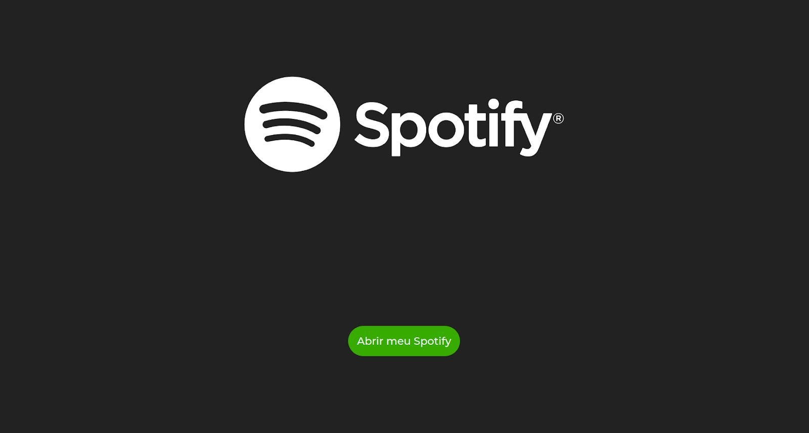
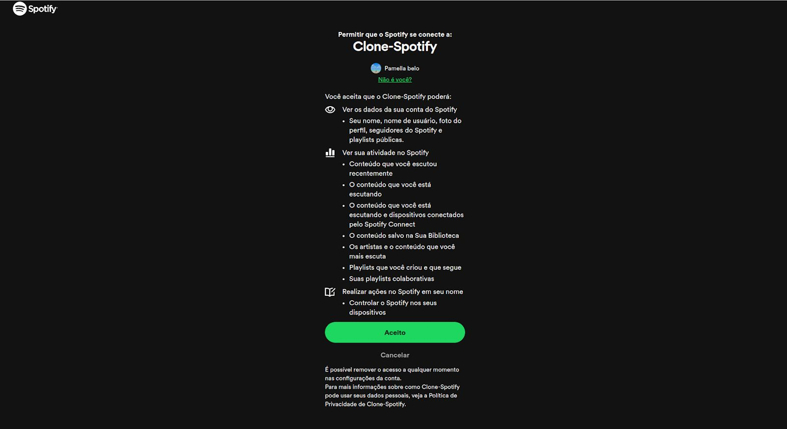
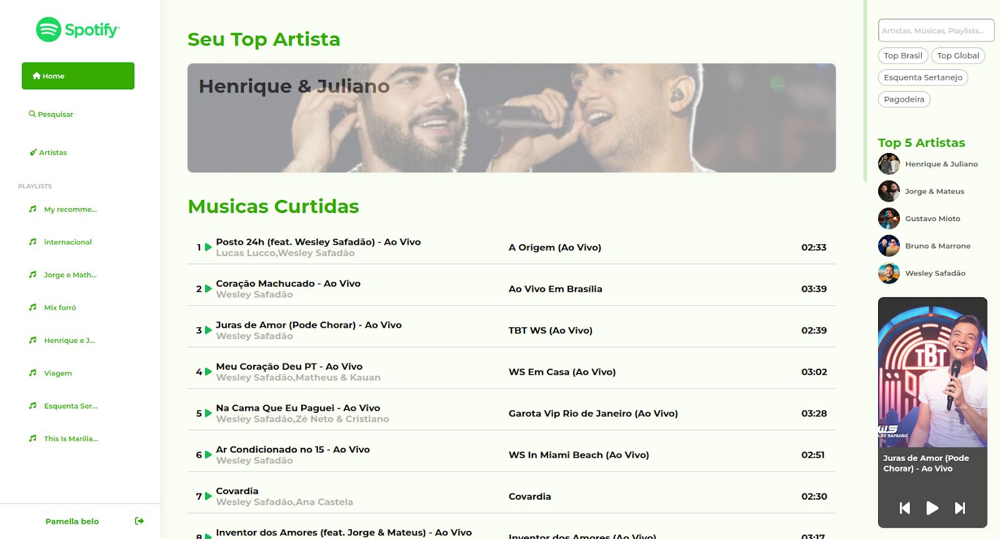
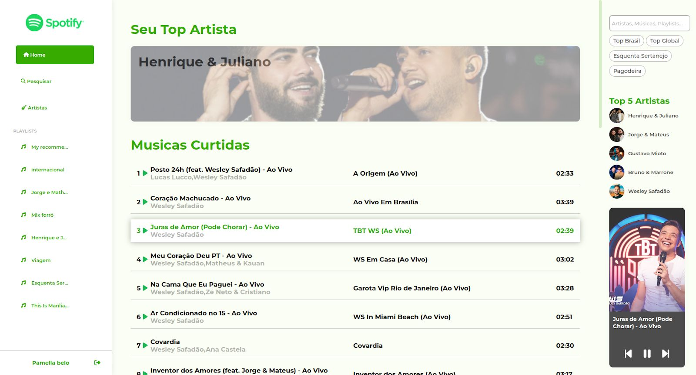
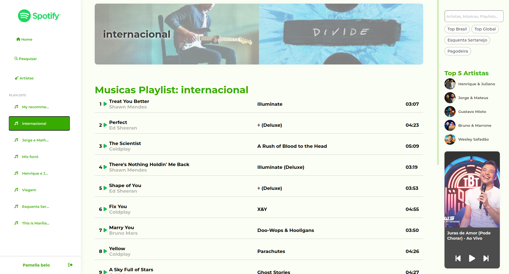

# Clone do Spotify com Angular

Este projeto é um **clone da interface web do Spotify**, desenvolvido com **Angular**. A proposta é simular a experiência de navegação da plataforma de streaming, focando na prática de conceitos como rotas, componentes, serviços, consumo de API e responsividade.

## 🚀 Tecnologias Utilizadas

- **Angular** 14+
- **TypeScript**
- **RxJS**
- **Angular Material**
- **SCSS**
- **HTML5**
- **Responsividade com Flex Layout**
- Integração com API do Spotify

## 🧠 Funcionalidades

- Tela de login com botão simulado
- Tela principal com playlists
- Player fixo no rodapé
- Listagem de álbuns, artistas e faixas
- Navegação entre páginas com Angular Router
- Consumo de API (mock ou real via Spotify Web API)
- Interface responsiva








## 📦 Como rodar o projeto localmente

```bash
# Clone o repositório
git clone https://github.com/PamellaBelo/Clone-Spotify.git

# Acesse a pasta do projeto
cd nome-do-repositorio

# Instale as dependências
npm install

# Inicie o servidor de desenvolvimento
ng serve


